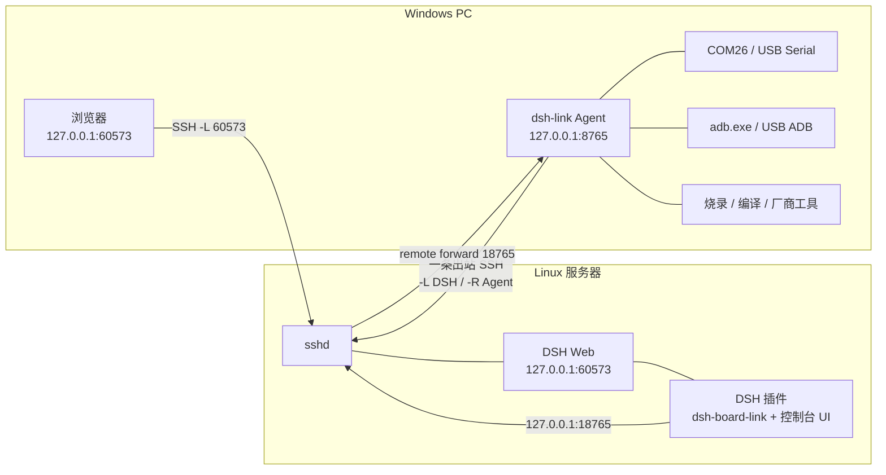
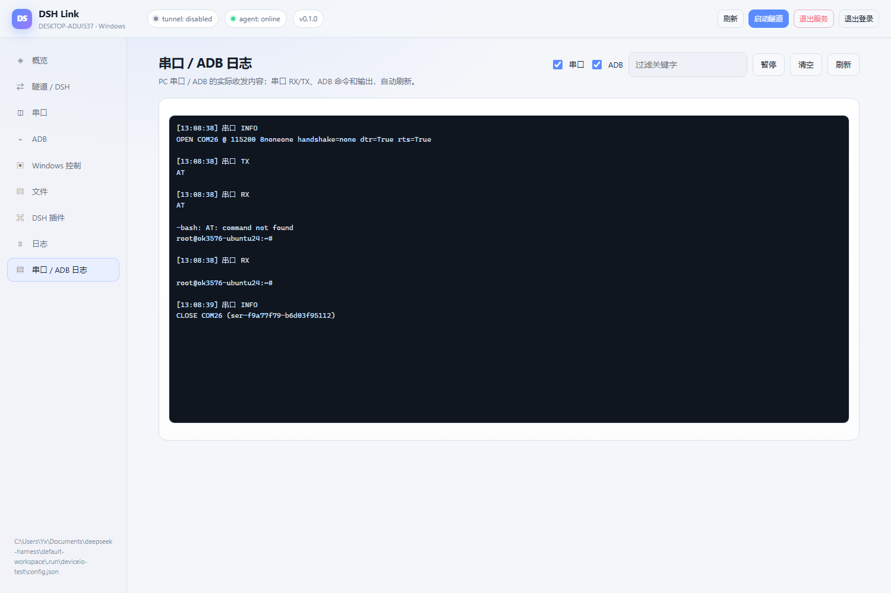
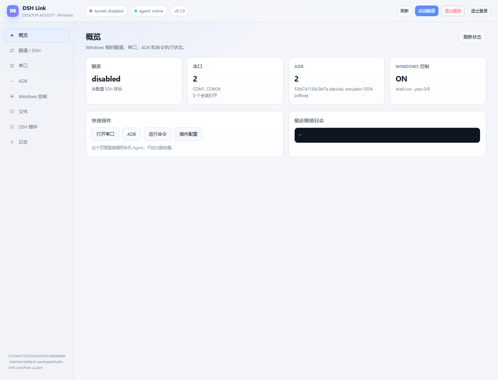
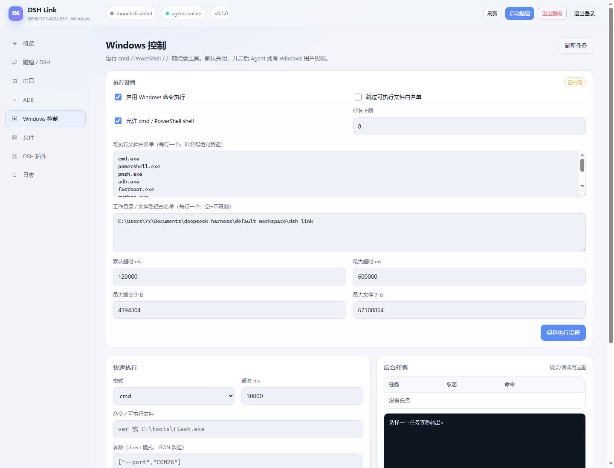
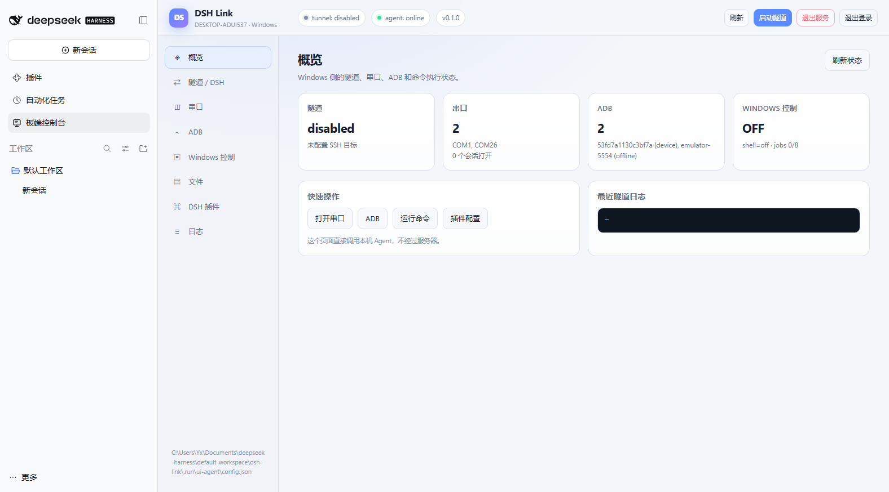

# DSH Link

把 Windows PC 变成 DSH 的「板端实验台」：一条出站 SSH 连接同时完成两件事：

1. **把服务器上的 DSH Web UI 转发到 Windows 本地浏览器**，本地访问 `http://127.0.0.1:60573` 即可使用服务器上的 DSH。
2. **把 Windows 上的串口和 ADB 能力反向暴露给服务器上的 DSH 插件**，让 DSH 能看串口日志、发命令、抓 logcat、传文件、装 APK、重启板子。
3. **可选地控制 Windows 本身**：运行 cmd/PowerShell、调用厂商烧录工具、启动编译/烧录任务并轮询日志、终止进程树。默认关闭，需要显式开启。
4. **在 DSH Web 的侧边栏直接打开「板端控制台」**：完整的串口 / ADB / Windows 控制台嵌在 DSH 主面板里，不需要另外开浏览器窗口。

服务器仍然负责改代码、编译、推理；Windows 只负责连接真实硬件。Windows 不需要公网 IP，也不需要开放入站防火墙端口。



## 这个方案解决什么问题

- 服务器上的 DSH 只能看到服务器自己的文件系统和进程，看不到你桌上的开发板。
- 串口工具（PuTTY、minicom、串口助手）和 ADB 都在 Windows 上，模型却运行在服务器上。
- 板子经常需要「看日志 → 改代码 → 重新烧写/安装 → 重启 → 再看日志」的闭环。

`dsh-link` 把这条链路做成一个可被 DSH 工具调用的稳定接口，而不是让模型去猜 SSH 命令或依赖人工复制粘贴。

## 为什么不是直接拿一个现成项目

可以复用的部分很多，但没有一个项目同时覆盖「Windows 端 + 出站隧道 + 串口/ADB + DSH 状态插件」：

| 需求 | 可复用方案 | 本项目的选择 |
|---|---|---|
| 加密隧道 | Windows 自带 OpenSSH | 直接调用 `ssh.exe`，一条连接同时做 `-L` 和 `-R` |
| 串口转 TCP | com0com + hub4com、ser2net | 自己实现 Windows 串口后端，保留 DTR/RTS 和会话 |
| USB 整体透传 | [usbipd-win](https://github.com/dorssel/usbipd-win) + Linux USB/IP | 不默认使用；需要把整个 USB 设备交给服务器时更合适 |
| 串口 MCP | [umeko-serial-mcp](https://pypi.org/project/umeko-serial-mcp/) 等 | 可用，但通常要求 MCP 服务器和硬件在同一台机器 |
| ADB MCP | [android-mcp-server](https://pypi.org/project/android-mcp-server/) 等 | 可用，但没有 DSH 插件状态检查和反向隧道 |
| 反向隧道 | frp、rathole、bore | SSH 已足够，且无需额外服务端 |

本项目的差异点是：**一个 Windows 程序 + 一个零依赖 DSH 插件 + 一条 SSH 连接**，并且 `board_status` 能同时报告隧道、串口、ADB 三者的状态。

## 已实现并实测的能力

在 Windows 10 + RK3576 Buildroot 开发板（USB ADB + CP210x `COM26`）上验证过：

- DSH 插件在真实 DSH 中成功注册 24 个工具。
- 串口枚举、打开、读取、写入、关闭；实测 `COM26 @ 115200 8N1` 能收到 shell 提示符并回写命令。
- ADB `devices`、`shell`、自动识别 Android/Buildroot 的日志读取。
- 文件 push/pull，截图保存到服务器。
- Windows 控制：`cmd`、PowerShell、direct 三种执行方式；后台任务启动/轮询/终止/超时/stdin；Windows 文件写入/读取/目录列表；中文输出编码已处理。
- 安全闸门：`exec.enabled=false`、`allowShell=false`、可执行文件白名单、工作目录白名单均实测返回 403。
- SSH 本地转发和反向转发同时工作；杀掉 SSH 后 Agent 自动重连；`/v1/tunnel/stop` 能真正结束 SSH 子进程。

## 快速开始

### 0. 前提

- 服务器：Linux，能 SSH 登录，DSH 正在运行。DSH Web 通常监听 `127.0.0.1:60573`。
- Windows：Windows 10/11，已安装 OpenSSH 客户端（`ssh.exe`）和 ADB（可选）。Windows 10 1809+ 默认带 OpenSSH 客户端；本地控制台使用 WebView2，Windows 10/11 的 Edge 通常已带 WebView2 Runtime。
- 服务器 `sshd` 允许 TCP 转发（默认 `AllowTcpForwarding yes`）。
- 建议使用 SSH 密钥，不使用密码。

### 推荐：用图形化控制台

不用手写 JSON。启动 Agent 后运行：

```powershell
& "$env:LOCALAPPDATA\DshLink\bin\dsh-link.exe" ui --config "$env:LOCALAPPDATA\DshLink\config.json"
```

或者运行 Agent 时加 `--ui`，启动后自动打开浏览器：

```powershell
& "$env:LOCALAPPDATA\DshLink\bin\dsh-link.exe" run --config "$env:LOCALAPPDATA\DshLink\config.json" --ui
```

**直接双击 `dsh-link.exe` 默认同时打开**：WebView2 原生控制台窗口（任务栏）+ 托盘后台 Agent。不会出现控制台黑框；关闭窗口后 Agent 继续在托盘运行。CLI 命令（`init`、`doctor`、`status`）仍然保留控制台输出。

需要本地控制台时运行：

```powershell
& "$env:LOCALAPPDATA\DshLink\bin\dsh-link.exe" --gui --config "$env:LOCALAPPDATA\DshLink\config.json"
```

或 `dsh-link.exe ui`。桌面「DSH Link」快捷方式也是窗口+托盘同时启动；如果只想托盘后台，使用 `--no-ui`。

### 托盘后台

启动后 Windows 通知区域会有一个 **DS 图标**，同时任务栏有原生控制台窗口按钮；关闭窗口后 Agent 继续在后台运行：

- 双击托盘图标：打开本地板端控制台；
- 右键菜单：打开控制台、复制 Agent token、退出服务；
- 关闭本地控制台窗口不会停 Agent，托盘还在；
- 只有「退出服务」才会停止隧道和 Agent。

Windows 10/11 默认会把**新出现的托盘图标放进 `^` 溢出区**，不会自动常驻。点开 `^`，把 **DSH Link** 图标拖到任务栏；如果溢出区里也没有，打开：

```text
设置 → 个性化 → 任务栏 → 其他系统托盘图标（或“选择哪些图标显示在任务栏上”）
```

把 **DSH Link** 打开。这个隐藏行为是 Windows 的设置，不是程序没创建图标。

这不是 SYSTEM 级的 Windows 服务，而是**当前用户登录后运行的后台托盘程序**；`install.ps1` 的登录自启动任务会打开原生控制台并保留托盘。需要在未登录/开机阶段就运行，才需要单独的 Windows 服务，但服务进程无法显示托盘。

### 串口 / ADB 输出栏

控制台左侧 **「日志」按钮下面**新增了一栏 **「串口 / ADB 日志」**，显示的是 **PC 程序实际打开串口/ADB 后的收发内容**，不是 Agent 服务日志，也不是独立窗口：



- **串口 RX**：板子通过串口打印出来的所有内容；
- **串口 TX**：PC 发到串口的命令/数据；
- **ADB CMD**：PC 执行的 adb 命令；
- **ADB OUT / ERR**：板端命令输出和错误输出；
- 另外记录串口 `OPEN/CLOSE/PULSE/FAULT` 事件；
- **串口 / ADB 两个勾选框**，可单独查看，也可同时显示；
- 每 1.5 秒自动刷新，支持关键字过滤、暂停/继续、清空；
- 自动滚动到底部，切走标签后停止轮询。

示例：

```text
[13:07:43] 串口 INFO
OPEN COM26 @ 115200 8Noneone handshake=none dtr=True rts=True

[13:07:44] 串口 TX
AT

[13:07:44] 串口 RX
AT
-bash: AT: command not found
root@ok3576-ubuntu24:~#
```

串口打印会保留最近约 4 MB / 2000 条；`清空` 会同时清空 PC 端内存缓冲。ANSI 终端控制符会在显示时去掉，避免乱码方块。

控制台地址是 `http://127.0.0.1:8765/ui`；`ui` 命令会带上 token 自动登录。页面右上角有 **退出服务**，用于真正结束后台 Agent。页面包含：

- **概览**：隧道、串口、ADB、Windows 控制状态。
- **隧道 / DSH**：SSH 目标、密钥、端口、自动重连，保存后自动重启隧道。
- **串口**：打开 COM 口、实时终端、发命令、DTR/RTS 复位。
- **ADB**：设备、shell、日志、截图、push/pull、安装 APK、重启。
- **Windows 控制**：exec 开关、白名单、工作目录、快捷执行、后台烧录任务。
- **文件**：浏览 Windows 目录、上传/下载文件。
- **DSH 插件**：显示 token/baseUrl，生成 profile YAML 和安装命令，直接下载插件 ZIP。
- **日志**：Agent 运行日志。





控制台本身是本地页面：HTML 可以匿名打开，但所有 API 都需要 `agent.token`。修改的配置会写回 `config.json`；**只有隧道配置真正变化时才重启 SSH**，改 Windows 控制/exec 配置不会断开本地 60573 的 DSH 转发。

启动生命周期：

- 桌面「DSH Link」同时打开原生控制台窗口和托盘；关闭窗口后只留托盘。
- 本地控制台是 **WebView2 原生窗口**，任务栏图标就是 DS，不会出现 Edge 浏览器图标或账号同步弹窗。
- WebView2 Runtime 不可用时会退回 Edge app（此时任务栏图标由 Edge 决定）。
- Agent 已在运行时再次打开控制台，会复用现有窗口，不会无限开新窗口。
- 点击「退出服务」会关闭控制台窗口并停止 Agent；关闭窗口本身不会停 Agent，托盘还在。

### DSH Web 里的「板端控制台」

新版插件会在 DSH Web 左侧导航增加 **板端控制台**。点开后，完整的串口 / ADB / Windows 控制台直接嵌在 DSH 中央面板里，不需要再单独开本地窗口。



实现方式：

- **Client UI**：插件注册 `sidebar.panellist` 和 `main`，在 DSH Web 增加导航项和主面板。
- **Host 代理**：插件在 DSH 的 `webServer` 上注册 `/board-link`，把请求转发到 Windows Agent（默认 `127.0.0.1:18765`）。
- **Token 不落到浏览器 URL**：代理在服务端注入 `Authorization: Bearer <agent.token>`；iframe 打开 `/board-link/ui` 后自动登录。
- **面板登录也能授权工具**：如果还没设置 `DSH_LINK_TOKEN`，在面板里手动登录一次，Host 会记住这个 token（`~/.dsh/board-link/token`，0600），随后 `board_status` 等工具调用也使用它；DSH 重启后仍然有效。
- **仅 loopback**：`/board-link` 只接受本机来源。通过 SSH 本地转发访问 DSH 的浏览器仍能正常使用；如果 DSH 直接暴露到局域网，该代理会返回 403。

如果面板显示「DSH Link 没有连上」，检查 Windows 上 Agent 和隧道：

```powershell
& "$env:LOCALAPPDATA\DshLink\bin\dsh-link.exe" status
```

```bash
ss -ltnp | grep 18765
```

更新时两端都要重启一次：

- **Windows**：用新 `dsh-link.exe` 覆盖后，先「退出服务」或结束旧 Agent，再双击启动；旧进程不会自动换 UI。
- **服务器 DSH**：重启后侧边栏才会出现新入口，并加载新的 Host 代理。

如果 DSH 面板仍显示 Agent 登录页，通常就是 Windows 端还在跑旧 Agent。

如果输入 Agent token 后出现 **404**：

- 先看 iframe 地址应为 `/board-link/ui`，不要带结尾 `/`；
- 新版插件已兼容旧 Agent 的绝对路径（会把 `/ui/api/*`、`/v1/*` 自动改写到 `/board-link` 下），刷新面板再试；
- 仍 404 时，确认 DSH 是通过本机/SSH 本地转发访问的（不是直连服务器 IP），并重启 DSH 载入最新插件；
- 最彻底的方式仍是更新 Windows Agent 并重启，让它使用新的相对路径和自动登录。

### 1. 在 Windows 上构建并安装 Agent

```powershell
cd dsh-link
.\scripts\publish.ps1          # 生成 dist\win-x64\dsh-link.exe（自包含单文件）
.\scripts\install.ps1          # 复制到 %LOCALAPPDATA%\DshLink\bin，生成配置，注册登录自启动
```

如果系统执行策略禁止运行本地 `.ps1`：

```powershell
powershell -NoProfile -ExecutionPolicy Bypass -File .\scripts\publish.ps1
powershell -NoProfile -ExecutionPolicy Bypass -File .\scripts\install.ps1
```

`install.ps1` 默认只在桌面创建 **DSH Link** 快捷方式：同时打开 WebView2 原生控制台（任务栏 DS 图标）和托盘，不弹浏览器/账号窗口。

快捷方式都通过隐藏窗口的 VBS 启动，不会闪黑框。脚本还会用 `schtasks /SC ONLOGON` 注册当前用户登录自启动；如果企业策略禁止，可加 `-NoAutostart`（或 `-NoShortcut`）。

发布产物是 **`dist\win-x64\dsh-link.exe` 单个自包含 exe**（约 64 MB，包含 .NET/WebView2 SDK，首次启动会解压到临时目录）；`install.ps1` 只复制这一个 exe。完整发布包在 `dist\dsh-link-0.1.0-win-x64.zip`；插件也可以单独分发：`dist\dsh-board-link-0.1.0.tgz`（推荐）或 `dist\dsh-board-link-0.1.0.zip`。

图标：exe/快捷方式/托盘/WebView2 原生窗口统一使用 `src\DshLink.Agent\Assets\dsh-link.ico` 的 DS 图标。只有 WebView2 初始化失败、退回 Edge 时，任务栏才会显示 Edge 图标。

如果只是开发调试：

```powershell
dotnet run --project src\DshLink.Agent -- init --config .\config.json
dotnet run --project src\DshLink.Agent -- doctor --config .\config.json
dotnet run --project src\DshLink.Agent -- run --config .\config.json
```

`init` 会生成一个随机 `agent.token`。把它记下来，服务器插件需要同一个值。

### 2. 配置 SSH

编辑 `%LOCALAPPDATA%\DshLink\config.json`（或 `config.example.json` 复制后修改）：

```json
{
  "agent": { "listen": "127.0.0.1", "port": 8765, "token": "这里填 init 生成的 token" },
  "tunnel": {
    "enabled": true,
    "ssh": {
      "target": "user@your-server",
      "port": 22,
      "identityFile": "C:\\Users\\you\\.ssh\\id_ed25519"
    },
    "forwards": [
      { "name": "dsh-web", "direction": "local",
        "listenHost": "127.0.0.1", "listenPort": 60573,
        "targetHost": "127.0.0.1", "targetPort": 60573 },
      { "name": "board-link", "direction": "remote",
        "listenHost": "127.0.0.1", "listenPort": 18765,
        "targetHost": "127.0.0.1", "targetPort": 8765 }
    ]
  }
}
```

- `local`：在 Windows 监听 `listenPort`，转发到服务器视角的 `targetHost:targetPort`。浏览器用这个端口。
- `remote`：在服务器监听 `listenPort`，转发回 Windows 的 `targetHost:targetPort`。DSH 插件用这个端口。

密钥准备（如果没有现成的）：

```powershell
ssh-keygen -t ed25519 -C "dsh-link"
type $env:USERPROFILE\.ssh\id_ed25519.pub | ssh user@your-server "mkdir -p ~/.ssh && cat >> ~/.ssh/authorized_keys"
ssh user@your-server "echo SSH_OK"
```

然后检查：

```powershell
$exe = "$env:LOCALAPPDATA\DshLink\bin\dsh-link.exe"
& $exe doctor --config "$env:LOCALAPPDATA\DshLink\config.json"
& $exe run    --config "$env:LOCALAPPDATA\DshLink\config.json"
```

启动后：

- 浏览器打开 `http://127.0.0.1:60573/?token=<DSH 启动时打印的 token>`。如果本地 60573 被占用，把 `dsh-web.listenPort` 改成例如 16073，并把 URL 端口也改成 16073；DSH 的 Host 检查接受任意 loopback 端口。
- 服务器上应能看到 `127.0.0.1:18765` 在监听：`ss -ltnp | grep 18765`。

### 3. 在服务器上安装 DSH 插件

**推荐用独立插件包 `.tgz`**，不依赖 ZIP 解压后的目录结构：

```bash
# 把 dsh-board-link-0.1.0.tgz 上传到服务器
bash scripts/install-plugin.sh web /absolute/path/dsh-board-link-0.1.0.tgz
# 等价于：
# dsh plugin --profile web add file:/absolute/path/dsh-board-link-0.1.0.tgz
```

也可以用独立插件 ZIP（先解压）或完整源码目录：

```bash
unzip dsh-board-link-0.1.0.zip -d /opt
bash scripts/install-plugin.sh web /opt/dsh-board-link
# 等价于：
# dsh plugin --profile web add link:/opt/dsh-board-link
```

`dsh plugin add` 会自动把 bundle 加入 `dsh.profile.bundles`，插件包同时包含 Host 工具和 Client UI。安装后重启 DSH Web，左侧导航会出现 **板端控制台**；如果只更新了 Host 没重启，旧页面仍会使用旧 bundle。

插件本身没有 npm 运行时依赖，不会在 profile 里再装一套 DSH 包。`link:` 依赖原目录，请把插件放在稳定路径（例如 `/opt/dsh-board-link`），不要安装后再移动。

> 如果报 `ENOENT ... plugin/dsh-board-link/package.json`，说明服务器上的目录不是完整的插件目录（常见于旧版 ZIP 在 Linux 上解压后路径错乱，或只复制了部分文件）。直接用上面的 `.tgz` 安装，或解压独立插件 ZIP 后确认：
>
> ```bash
> ls /path/to/dsh-board-link/package.json
> ```

> 如果之前测试装过旧插件、或 `dsh plugin add` 后仍报旧路径/看不到插件，重启一次服务器的 DSH，让 profile loader 释放旧的 bundle 状态，然后重新执行安装命令。重启后仍建议用 `board_status` 确认新版本已加载。

让 DSH 进程看到 token：

```bash
export DSH_LINK_TOKEN='init 生成的 agent.token'
dsh web
```

如果 DSH 由 systemd 启动，在 unit 中加：

```ini
Environment=DSH_LINK_TOKEN=xxxxx
```

或者不设环境变量，在 `~/.dsh/profiles/web/cordis.patch.yml` 里覆盖配置：

```yaml
- id: board-link
  config:
    baseUrl: 'http://127.0.0.1:18765'
    timeoutMs: 15000
    token: 'xxxxx'
```

> 修改 profile patch 后，DSH 会按 HMR 重载；如果没有 HMR，重启 DSH。

### 4. 验证

在 DSH 里让它调用：

```text
调用 board_status，检查 Windows agent、隧道、串口和 ADB 是否正常。
```

正常输出大致是：

```text
dsh-link 0.1.0 on DESKTOP-XXXX — ONLINE
agent: 127.0.0.1:8765 (pid 1234, uptime 30s)
token: configured
tunnel: running pid=5678 target=user@server
forwards: dsh-web: local 127.0.0.1:60573 -> 127.0.0.1:60573; ...
serial ports: COM1, COM26
open serial sessions: none
adb: Android Debug Bridge version 1.0.41 ...; 1 device(s)
- 53fd...: device
```

然后可以：

```text
board_serial_open 打开 COM26，115200，8N1
board_serial_read 读取 1000ms
board_serial_write 写入 "uname -a\r"
board_adb_shell 执行 "uname -a"
board_adb_logcat 读取 50 行
```

## DSH 工具列表

| 工具 | 作用 |
|---|---|
| `board_status` | 一次检查隧道、串口、ADB，排障入口 |
| `board_serial_list` | 列出 Windows COM 口和已打开会话 |
| `board_serial_open` | 打开串口（波特率、数据位、校验、停止位、流控、DTR/RTS） |
| `board_serial_read` | 从会话缓冲区读数据，支持超时/peek/最大字节 |
| `board_serial_write` | 写文本或 base64，支持 LF/CRLF |
| `board_serial_close` | 关闭会话，释放 COM 口 |
| `board_serial_pulse` | 脉冲 DTR/RTS，用于复位或进入 bootloader |
| `board_adb_devices` | 列出 ADB 设备 |
| `board_adb_shell` | 在板端执行 shell 命令，返回 stdout/stderr/exit code |
| `board_adb_logcat` | 自动识别 Android logcat 或 Buildroot `/var/log/messages` |
| `board_adb_screenshot` | 截图并保存到 DSH 服务器 |
| `board_adb_push` | 把服务器上的文件推到板子 |
| `board_adb_pull` | 把板子上的文件拉到服务器 |
| `board_adb_install` | 安装 APK |
| `board_adb_reboot` | 重启到 system/bootloader/recovery/sideload/fastboot |
| `windows_exec` | 在 Windows 上运行短命令（cmd/PowerShell/direct），等待并返回输出 |
| `windows_job_start` | 启动后台 Windows 任务，立即返回 jobId；适合烧录/编译 |
| `windows_job_status` | 轮询任务状态和最新 stdout/stderr |
| `windows_job_input` | 给运行中的任务写 stdin，可关闭 stdin |
| `windows_job_kill` | 终止任务及其进程树 |
| `windows_jobs` | 列出运行中和最近完成的任务 |
| `windows_write_file` | 把 DSH 服务器上的文件（固件/APK/脚本）复制到 Windows |
| `windows_read_file` | 把 Windows 文件复制回 DSH 服务器 artifact 目录 |
| `windows_list_dir` | 列出 Windows 目录 |

串口会话在 Agent 进程内保持，跨工具调用有效；DSH 插件重载不会关闭会话。Agent 重启会关闭所有会话。

## 配置参考

完整字段见 [`config.example.json`](config.example.json)。

| 字段 | 默认 | 说明 |
|---|---|---|
| `agent.listen` | `127.0.0.1` | **只建议 loopback**；改成 `0.0.0.0` 会暴露串口/ADB 能力 |
| `agent.port` | `8765` | Agent HTTP 端口 |
| `agent.token` | 随机生成 | 所有 `/v1/*` 请求需要 `Authorization: Bearer <token>` |
| `agent.maxBodyBytes` | 128 MiB | 请求体上限；会按 `adb.maxTransferBytes` 自动放大 |
| `tunnel.enabled` | `false`（init 生成） | 是否启动 SSH |
| `tunnel.ssh.target` | 空 | `user@host` |
| `tunnel.ssh.port` | `22` | SSH 端口 |
| `tunnel.ssh.identityFile` | 空 | 私钥路径；建议使用 ed25519 |
| `tunnel.ssh.knownHostsFile` | 空 | 默认使用 OpenSSH 的 known_hosts |
| `tunnel.ssh.strictHostKeyChecking` | `accept-new` | 首次接受新主机；生产可改 `yes` |
| `tunnel.ssh.extraOptions` | `{}` | 额外 `-o key=value` |
| `tunnel.forwards` | DSH + Agent | 转发规则，`local` 或 `remote` |
| `tunnel.restart.enabled` | `true` | SSH 退出后自动重连 |
| `serial.bufferBytes` | 1 MiB | 每个串口会话的环形缓冲 |
| `serial.idleTimeoutSeconds` | `0` | 0 表示不自动关闭 |
| `adb.path` | `adb` | adb 可执行文件；默认从 PATH 查找 |
| `adb.defaultTimeoutMs` | `30000` | ADB 命令默认超时 |
| `adb.maxOutputBytes` | 1 MiB | stdout 截断上限 |
| `adb.maxTransferBytes` | 64 MiB | push/pull/install 上限 |
| `exec.enabled` | `false` | **是否允许远程执行 Windows 命令；默认关闭** |
| `exec.allowAny` | `false` | true 时跳过可执行文件白名单 |
| `exec.allowShell` | `false` | 是否允许 `cmd`/`powershell` 模式；这两者本身可执行任意命令 |
| `exec.cmdPath` / `exec.powerShellPath` | `cmd.exe` / `powershell.exe` | shell 路径；可换成 `pwsh.exe` |
| `exec.allowedExecutables` | 常见工具 | 可执行文件叶名或绝对路径；`*` 表示全部 |
| `exec.allowedWorkingRoots` | `[]` | 允许的 cwd/文件路径根目录；空表示不限制 |
| `exec.defaultTimeoutMs` / `maxTimeoutMs` | 120s / 600s | 命令/任务超时 |
| `exec.maxOutputBytes` | 4 MiB | 每个任务的输出缓冲 |
| `exec.maxFileBytes` | 64 MiB | Windows 文件读写上限 |
| `exec.maxJobs` | 8 | 同时运行的任务数 |
| `exec.jobRetentionSeconds` | 600 | 完成任务保留时间 |
| `logging.directory` | `%LOCALAPPDATA%\DshLink\logs` | 日志目录，自动轮转 |
| `logging.level` | `information` | trace/debug/information/warning/error |

## HTTP API

Agent 只监听 loopback；以下请求都需要 Bearer token。

| 方法 | 路径 | 说明 |
|---|---|---|
| GET | `/ui` | 图形化控制台 HTML（登录页公开） |
| GET | `/healthz` | 无鉴权存活检查，仅返回 `{"ok":true}` |
| GET | `/v1/health` | 完整状态：隧道、串口、ADB、版本 |
| POST | `/v1/ui/open` | 聚焦/复用或打开控制台窗口（需 token） |
| POST | `/v1/shutdown` | 受控停止 Agent，并关闭控制台窗口 |
| GET | `/v1/config` | 脱敏配置（不含 token） |
| GET/POST | `/ui/api/config` | 控制台读取/保存隧道与 exec 配置（需 token） |
| GET | `/ui/api/plugin.zip` | 下载内嵌的 DSH 插件 ZIP（需 token） |
| GET | `/ui/api/device-io` | 读取串口 RX/TX 与 ADB 命令/输出缓冲（需 token） |
| POST | `/ui/api/device-io/clear` | 清空串口/ADB 输出缓冲（需 token） |
| POST | `/v1/tunnel/start` / `stop` / `restart` | 控制 SSH 隧道 |
| GET | `/v1/serial/ports` | 枚举 COM 口 |
| GET | `/v1/serial/sessions` | 列出会话 |
| POST | `/v1/serial/open` | 打开串口 |
| POST | `/v1/serial/read` | 读取（支持 timeoutMs、maxBytes、peek） |
| POST | `/v1/serial/write` | 写 text/base64，支持 newline |
| POST | `/v1/serial/pulse` | 脉冲 DTR/RTS |
| POST | `/v1/serial/close` | 关闭会话 |
| GET | `/v1/adb/status` / `/v1/adb/devices` | ADB 状态/设备 |
| POST | `/v1/adb/shell` | 执行 shell |
| POST | `/v1/adb/logcat` | Android/Buildroot 日志 |
| POST | `/v1/adb/screenshot` | 截图，返回 base64 |
| POST | `/v1/adb/push` / `pull` | 文件传输 |
| POST | `/v1/adb/install` | 安装 APK |
| POST | `/v1/adb/reboot` | 重启 |
| GET | `/v1/exec/status` | Windows exec 开关和白名单状态 |
| POST | `/v1/exec` | 前台执行 Windows 命令 |
| POST | `/v1/jobs` | 启动后台 Windows 任务 |
| GET | `/v1/jobs` / `/v1/jobs/{id}` | 任务列表/状态与输出尾部 |
| POST | `/v1/jobs/{id}/stdin` | 写入任务 stdin |
| POST | `/v1/jobs/{id}/kill` | 终止任务树 |
| POST | `/v1/files/write` / `read` | Windows 文件写入/读取（base64） |
| GET | `/v1/files/list?path=` | 列出 Windows 目录 |

## 串口注意事项

- **打开串口会拉 DTR/RTS**。很多 ESP32/STM32 板子会因此复位。如果不想复位，设置 `"dtr": false` 或 `"rts": false`。
- Windows 同一时刻只允许一个进程打开同一个 COM 口。先关闭 PuTTY、串口助手、厂商烧录工具。
- 板端控制台通常是 `115200 8N1`；Linux 启动日志早期可能是 `1500000` 或其他波特率。
- `board_serial_read` 返回「当前已有数据」就立刻返回，不保证一次读满一行。需要更完整的输出时，循环读取或增大 `timeoutMs`。
- 二进制数据用 `base64` 字段；文本用 `text` 字段。

## ADB / Buildroot 注意事项

- Android：`board_adb_logcat` 使用 `logcat -d -t N -v threadtime`。
- Buildroot/Linux：自动检测不到 `getprop` 时改为 `tail -n N /var/log/messages`，失败再尝试 `dmesg`。
- 自定义日志文件（例如 `/var/log/myapp.log`）用 `board_adb_shell`：
  ```text
  board_adb_shell command="tail -n 200 /var/log/myapp.log"
  ```
- 板子上的 `logcat` 可能是 BusyBox 的 `tail` 包装脚本，不一定支持 Android 的 `-d`。插件的 `platform` 参数可强制 `linux`。
- `board_adb_devices` 里出现 `unauthorized` 时，在板端确认 USB 调试授权；出现 `offline` 时重新插拔或 `adb kill-server`。

## 控制 Windows（可选，高风险）

很多烧录/编译工具只有 Windows 版（厂商烧录器、`flash.bat`、`esptool`、`fastboot`、专用 CLI）。打开 `exec` 后，DSH 可以直接调用它们。

### 开启

编辑 Windows 配置：

```json
{
  "exec": {
    "enabled": true,
    "allowAny": false,
    "allowShell": true,
    "allowedExecutables": [
      "cmd.exe", "powershell.exe", "pwsh.exe",
      "adb.exe", "fastboot.exe", "python.exe", "esptool.py",
      "rkdeveloptool.exe", "upgrade_tool.exe"
    ],
    "allowedWorkingRoots": ["C:\\work"],
    "defaultTimeoutMs": 120000,
    "maxTimeoutMs": 600000,
    "maxOutputBytes": 4194304,
    "maxFileBytes": 67108864,
    "maxJobs": 8
  }
}
```

- `allowShell=true` 才能用 `cmd`/`powershell` 模式；这两个 shell 本身可以调用任意程序，所以这是一次「全权委托」。
- 如果只想开放固定工具，保持 `allowShell=false`，用 `mode=direct` 指定可执行文件和参数。
- `allowedExecutables` 支持叶名（`flash.exe`）或绝对路径；`allowAny=true` 跳过白名单（不建议）。
- `allowedWorkingRoots` 限制 `cwd` 和 Windows 文件读写路径；空数组表示不限制。建议至少限制到项目目录。
- 修改配置后重启 `dsh-link`。
- 如果烧录工具需要管理员权限（USB 驱动、厂商烧录器常见），`dsh-link` 也必须以管理员身份运行，否则会报 `Access denied`。自动启动任务可以在任务计划程序里勾选「使用最高权限运行」。

### 短命令：windows_exec

```text
windows_exec mode=cmd command="echo %CD% & build.bat" cwd="C:\work\board"
windows_exec mode=powershell command="Get-ChildItem C:\work\board"
windows_exec mode=direct command="C:\tools\flash.exe" args=["--port","COM26","firmware.bin"]
```

默认 `timeoutMs` 来自 `exec.defaultTimeoutMs`。前台调用适合几十秒内结束的命令；更长的任务用 job。

### 长任务/烧录：windows_job_start

```text
windows_job_start mode=cmd command="flash.bat" cwd="C:\work\board" timeoutMs=600000
```

返回 `jobId` 后轮询：

```text
windows_job_status jobId="job-..." tailChars=8000
windows_job_kill jobId="job-..."
windows_jobs
```

烧录/编译通常几分钟，用 job 可以避免 HTTP 超时。任务超时会被标记为 `timed_out` 并杀掉进程树；`windows_job_kill` 也可以手动终止。需要交互确认时用 `windows_job_input` 写 stdin。

### 输出编码

- `cmd` 默认按 Windows OEM 代码页解码（中文系统为 GBK/936）。
- `powershell` 默认强制 UTF-8 输出，所以中文日志能正确返回；如果显式传 `encoding=oem`/`utf16` 则按指定编码解码。
- `direct` 默认 UTF-8；老式工具可用 `encoding=oem`。

### 固件传输：windows_write_file / windows_read_file

如果固件是在服务器上编译的，先复制到 Windows，再调用烧录工具：

```text
windows_write_file localPath="/home/me/build/firmware.bin" windowsPath="C:\work\board\firmware.bin"
windows_job_start mode=cmd command="flash.bat" cwd="C:\work\board"
windows_job_status jobId="job-..." tailChars=12000
```

反向复制日志/抓包：

```text
windows_read_file windowsPath="C:\work\board\flash.log"
windows_list_dir path="C:\work\board"
```

文件路径同样受 `exec.allowedWorkingRoots` 限制；`exec.maxFileBytes` 控制单文件上限。`windows_write_file`/`windows_read_file` 需要 `exec.enabled=true`。

### 示例：从 DSH 完成一次烧录

```text
windows_write_file localPath="/home/me/build/firmware.bin" windowsPath="C:\work\board\firmware.bin"
windows_job_start mode=cmd command="flash.bat" cwd="C:\work\board"
windows_job_status jobId="job-..." tailChars=12000
# 如果脚本要求确认：
windows_job_input jobId="job-..." text="y\n"
# 失败时：
windows_job_kill jobId="job-..."
```

## 安全

- **`exec` 是远程代码执行能力，默认关闭。** 开启后，任何持有 agent token 的调用方都能在 Windows 用户权限下运行被允许的程序。只在你信任的 DSH、模型和网络里启用。
- **Agent 只绑定 `127.0.0.1`**。SSH 反向转发也只绑定服务器 `127.0.0.1`。
- `agent.token` 是唯一认证；请使用 32 字节以上随机值，不要提交到 Git。面板登录后 Host 会把 token 缓存在服务器 `~/.dsh/board-link/token`（0600）；删除该文件即可清除缓存。
- SSH 使用密钥 + `BatchMode=yes`，不会在后台弹密码框。
- 服务器上的其他本地用户理论上能访问 `127.0.0.1:18765`，但需要 token；不要把该端口改成 `0.0.0.0`。
- `board_adb_shell` 和串口写入相当于对板子的远程执行/输入能力，这是设计目的；请通过 DSH 的权限策略控制模型可用工具。
- `board_adb_push` 和 `board_adb_install` 会读取 DSH 服务器上模型指定的任意可读路径。不要把该工具暴露给不可信模型；更稳妥的做法是让 DSH 使用专用低权限账号运行。
- `windows_read_file` 可以把 Windows 上的任意可读文件（在 `allowedWorkingRoots` 内）复制回服务器；`windows_write_file` 可以覆盖 Windows 文件。开启 exec 时请同时收紧这两个白名单。
- 截图/pull 的文件会写到 DSH 服务器上的 `artifactDir`（默认 `~/.dsh/board-link/artifacts`）。
- DSH Web 的启动 URL 带 token，转发后不要把这个 URL 发给别人。

## 故障排查

### `board_status` / DSH 面板代理报 401

现象：隧道和 `http://127.0.0.1:18765/v1/health` 能连上，但返回：

```text
401 unauthorized: send Authorization: Bearer <agent.token>
```

说明链路是通的，只是 **DSH 进程里没有 token**。不用生成新 token，直接用 Windows 上已有的那一个。

**如果是新版插件**：在 DSH 的「板端控制台」里用 Agent token 登录一次即可。Host 会捕获并保存这次登录的 token 到 `~/.dsh/board-link/token`（权限 0600），之后的 `board_status`、串口/ADB 工具都会用它；DSH 重启后也仍然有效，**不用设置 `DSH_LINK_TOKEN`**。

如果不想让 Host 保存 token，也可以把同一个 token 写进 profile patch。在 Windows 上取出 token：

```powershell
& "$env:LOCALAPPDATA\DshLink\bin\dsh-link.exe" print-token --config "$env:LOCALAPPDATA\DshLink\config.json"
```

**最省事：写进 profile patch，持久化，不用每次 export，也不用改 systemd。** 编辑 `~/.dsh/profiles/web/cordis.patch.yml`（profile 名/`DSH_HOME` 按实际替换）：

```yaml
- id: board-link
  config:
    baseUrl: 'http://127.0.0.1:18765'
    timeoutMs: 15000
    token: '粘贴刚才的 agent.token'
```

如果文件里已有 `- id: board-link`，只改其中的 `token:`，不要重复添加。保存后重启 DSH 即可。

另一种方式是设置环境变量（适合临时调试）：

```bash
export DSH_LINK_TOKEN='粘贴 Windows 的 agent.token'
dsh --profile web
```

或者写进 `~/.dsh/profiles/web/cordis.patch.yml`（`DSH_HOME` 不同时替换路径）：

```yaml
- id: board-link
  config:
    baseUrl: 'http://127.0.0.1:18765'
    timeoutMs: 15000
    token: '粘贴 agent.token'
```

然后**重启 DSH 进程**。如果由 systemd 启动，`export` 不会自动生效，需要在 unit 里加：

```ini
Environment=DSH_LINK_TOKEN=粘贴 agent.token
```

验证：

```bash
curl -sS -H "Authorization: Bearer $DSH_LINK_TOKEN" \
  http://127.0.0.1:18765/v1/health
```

返回 `{"ok":true,...}` 即正确；不带 Authorization 返回 401 是正常的。

如果 token 里可能带换行，用 `print-token` 输出的单行值；不要带 `Bearer ` 前缀写进配置。

### `remote port forwarding failed` / `Address already in use`

服务器 `18765` 被占用：

```bash
ss -ltnp | grep 18765
```

改 Windows 配置里的 `board-link.listenPort`，同时改插件 `baseUrl` 的端口。

### Windows 本地 `60573` 被占用

说明本机也运行了 DSH 或其他服务。把 `dsh-web.listenPort` 改成 `16073`，浏览器访问 `http://127.0.0.1:16073/?token=...`。DSH 的 `/api` Host 检查接受任意 loopback 端口。

### `Permission denied (publickey)`

- `identityFile` 路径是否正确；
- 公钥是否在服务器 `~/.ssh/authorized_keys`；
- 服务器 `~/.ssh` 权限是否为 `700`，`authorized_keys` 是否为 `600`；
- 用 `ssh -i <key> user@server` 手动验证。

### `ssh: Could not resolve hostname`

`tunnel.ssh.target` 写错，或 Windows 的 DNS/VPN 没连上。

### 串口打开失败 `Access denied`

COM 口被其他程序占用。关闭 PuTTY、串口助手、烧录工具后重试。

### 板子一打开串口就复位

设置 `dtr: false`，或先打开串口再给板子上电。部分板子的自动复位电路对 DTR/RTS 很敏感。

### ADB 不可用

`dsh-link.exe doctor --config <配置路径>` 会显示 adb 路径。也可以显式配置 `"adb": { "path": "D:\\platform-tools\\adb.exe" }`。

## 开发与测试

```powershell
# 编译
dotnet build src\DshLink.Agent\DshLink.Agent.csproj

# 插件单元测试（不需要硬件）
node plugin\dsh-board-link\test\unit.mjs

# 端到端 smoke（需要真实串口；ADB 设备可选，会读写 COM26）
$env:DSH_LINK_CONFIG = "$env:LOCALAPPDATA\DshLink\config.json"
$env:DSH_LINK_PORT = "8765"
$env:DSH_LINK_SERIAL_PORT = "COM26"
node plugin\dsh-board-link\test\smoke.mjs

# Windows 控制 smoke（需要 exec.enabled=true）
$env:DSH_LINK_URL = "http://127.0.0.1:8765"
$env:DSH_LINK_TOKEN = "<agent.token>"
node plugin\dsh-board-link\test\windows-smoke.mjs
```

smoke 默认读取 `.run/config.json`，也可用 `DSH_LINK_CONFIG`、`DSH_LINK_PORT`、`DSH_LINK_SERIAL_PORT` 指定；运行前先启动 Agent。测试内容包括 24 个工具注册、`board_status`、串口打开/读/写/关闭；如果有 ready 的 ADB 设备，还会测 shell、logcat、push/pull 回读校验。设置 `DSH_LINK_REQUIRE_ADB=1` 可要求 ADB 必须可用。

SSH 隧道可以单独用本地临时 sshd 验证；测试脚本不随仓库提供自动启动，避免误开端口。手工验证步骤见 `docs/VALIDATION.md`。

## 开源组件与替代路线

- [OpenSSH for Windows](https://learn.microsoft.com/windows-server/administration/openssh/openssh-overview)：隧道实现，系统自带。
- [usbipd-win](https://github.com/dorssel/usbipd-win)：需要把整个 USB 设备（而不只是串口/ADB）交给服务器时使用；Linux 侧需要 USB/IP 内核模块，配置和权限要求更高。
- [com0com + hub4com](https://sourceforge.net/projects/com0com/)：Windows 虚拟串口和串口转 TCP 的经典组合，但需要自己拼装隧道和 DSH 集成。
- [ser2net](https://github.com/cminyard/ser2net)：Linux 侧串口网络化，适合服务器直接接串口，不适合 USB 在 Windows 的场景。
- [umeko-serial-mcp](https://pypi.org/project/umeko-serial-mcp/)、[android-mcp-server](https://pypi.org/project/android-mcp-server/)：如果只需要 MCP 工具、且硬件和 MCP 服务器在同一台机器，可以直接用；跨 Windows/服务器时仍需隧道和状态检查。

## 目录结构

```text
dsh-link/
├─ src/DshLink.Agent/          Windows Agent（.NET 10，无第三方 NuGet 依赖）
│  └─ Ui/index.html            内嵌的图形化控制台（浏览器 UI）
├─ plugin/dsh-board-link/      DSH 插件（纯 ESM，零运行时依赖）
├─ scripts/                    发布、安装、服务器插件安装
├─ config.example.json
└─ docs/                       实测记录与控制台截图
```

## 后续可以加

- 托盘图标目前是当前用户会话级别，不是开机即运行、无用户的 Windows 服务。
- WebSocket/SSE 串口实时流，替代轮询读取。
- MCP 端点，让非 DSH 客户端也能用同一台 Windows 实验台。
- USB/IP 整体透传模式。
- Windows 服务安装（当前用登录自启动任务）。
- 多板卡/多串口并行采集和环形日志。
